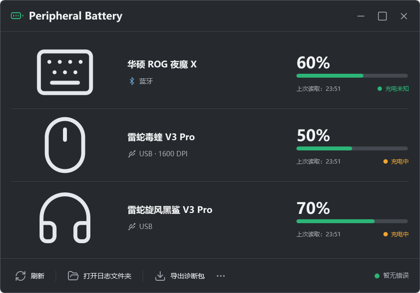

# Peripheral Battery

Windows 外设电量组件，集中查看 ROG Azoth X、Razer Viper V3 Pro 和
Razer BlackShark V3 Pro 的电量、连接方式、充电状态及鼠标 DPI。
当前为 0.1.1 预览版本，适配范围限于下表设备，不是通用外设管理器。



截图使用模拟电量展示布局，不是用户的实时设备记录。

## 下载与使用

下载 `Peripheral-Battery-v0.1.1-win-x64.zip`，完整解压到当前用户可写的
固定目录，例如 `D:\PeripheralBattery`，双击 `PeriDock.exe`。
运行包自带 .NET，无需安装 SDK、Python 或 Node.js。
不要直接在压缩包内启动；不要放到需要管理员权限才能写入的目录。

初次启动会在 Windows 通知区域常驻，悬浮条默认隐藏。
右键通知区域图标，勾选“显示悬浮窗”即可显示，程序会记住此选择。
单击打开基本信息小窗，双击打开详情；悬停只显示简短提示。
详情窗底部“...”按钮也可打开设置，勾选“开机启动”可启用当前用户登录启动。
更改程序目录前先关闭“开机启动”，移动后重新勾选。
退出后再次双击程序即可重启，也可给 `PeriDock.exe` 创建桌面快捷方式。

## 0.1.1 更新

- 更换应用图标：深色底、浅色电池轮廓与绿色电量格。
- 托盘采用独立的透明背景图标，在通知区域更清晰。
- 两套 ICO 均包含 16、20、24、32、40、48、64、128、256px 九种尺寸。
- 本次仅更新图标及版本标识，设备读取和交互行为沿用上一版。

从 0.1.0 升级：先退出组件，再将运行包完整解压覆盖到原目录；保留原有
`data/` 设置、`logs/` 和 `diagnostics/`。运行包不会携带这些个人文件。

## 设备支持

| 设备 | 已在本机实测 | 仍需进一步验证 |
| --- | --- | --- |
| ROG Azoth X / 夜魔 X | 蓝牙电量；USB 电量与充电读数 | 专用 2.4G、OMNI、长时间切换 |
| Razer Viper V3 Pro / 毒蝰 V3 Pro | USB 与 2.4G 电量、充电状态、1600 DPI 读数 | 其他固件、更多 DPI 值 |
| Razer BlackShark V3 Pro / 旋风黑鲨 V3 Pro | USB 与 2.4G 电量、充电状态；与鼠标同时有线读取 | 本机蓝牙、多路连接、反复切换 |

协议入口存在不等于所有固件均已实测。设备名称相似的 Xbox / PlayStation
版本或其他代际产品可能使用不同接口，不在本次支持承诺中。
键盘当前蓝牙固件只提供电量，没有可读充电状态，因此显示“充电未知”。
鼠标 DPI 为读取值，本程序不会修改 DPI、灯光、音效或固件。
读数约每 30 秒刷新，连续失败时退避；灰色电量表示过期数据或系统缓存。
耳机连接方式表示已确认的设备通道，不表示 Windows 默认音频输出。

## 系统与运行时

- Windows 10 2004 / build 19041 或更高版本，x64。
- 已在一台 Windows 11 电脑实测，未完成 Windows 10、干净系统或 ARM64 实测。
- 运行包包含 .NET 8.0.33，应用本身未进行代码签名。
- 截至 2026-11-09 查询到的 .NET 8 支持结束日期为 2026-11-10。
  长期维护应迁移到仍受支持的 .NET 版本后重新验证和发布。
  官方生命周期信息：<https://dotnet.microsoft.com/platform/support/policy/dotnet-core>。

## 数据与诊断

数据默认保存在程序目录下：`data/` 为设置与当前读数，`logs/` 为日志和崩溃记录，
`diagnostics/` 为用户主动导出的诊断 ZIP。应用不自动上传日志。
日志写入失败时会尝试当前用户的 LocalAppData/PeriDock/logs。
日志默认轮换保留 14 天、总量约 50 MB。
诊断导出会过滤常见用户名路径、设备路径和蓝牙地址；
分享诊断包前仍应检查内容，不要把整个运行目录提交到 GitHub。

## 从源码构建

在 Windows 上安装 .NET 8 SDK，然后在仓库根目录运行：

```powershell
dotnet run --project src/tests/PeriDock.Tests.csproj -c Release
dotnet build src/PeriDock.csproj -c Release
dotnet run --project src/ui-checks/PeriDock.UiChecks.csproj -c Release
dotnet publish src/PeriDock.csproj -c Release -r win-x64 --self-contained true -p:DebugType=None -p:DebugSymbols=false -o dist/Peripheral-Battery-win-x64
```

UI 检查默认使用仓库中的模拟数据，截图写入 UI 检查程序输出目录的 `renders/`。
也可传入自己的状态 JSON 和截图输出目录作为两个参数。
公开源码包不含个人状态、日志、设计原图或任何开发 SDK。

发布二进制前应将根目录 LICENSE、README.md、THIRD-PARTY.md、docs/licenses/
一并放入发行包。自包含 .NET 的许可证及第三方声明也应随发行包携带，
本次准备的运行 ZIP 已包含这些文件。

## 许可证与图片

本项目原创代码采用 MIT 许可证。第三方代码及图标保留各自许可证，
具体来源见 [THIRD-PARTY.md](THIRD-PARTY.md)。
公开版设备图片使用 Lucide 通用图标生成，应用与托盘使用原创电池图标，
未打包本机私人版本中的厂商产品照片或用户提供的设计参考图。
ASUS、ROG、Razer 及产品名称归各自权利人所有；本项目为非官方工具。
